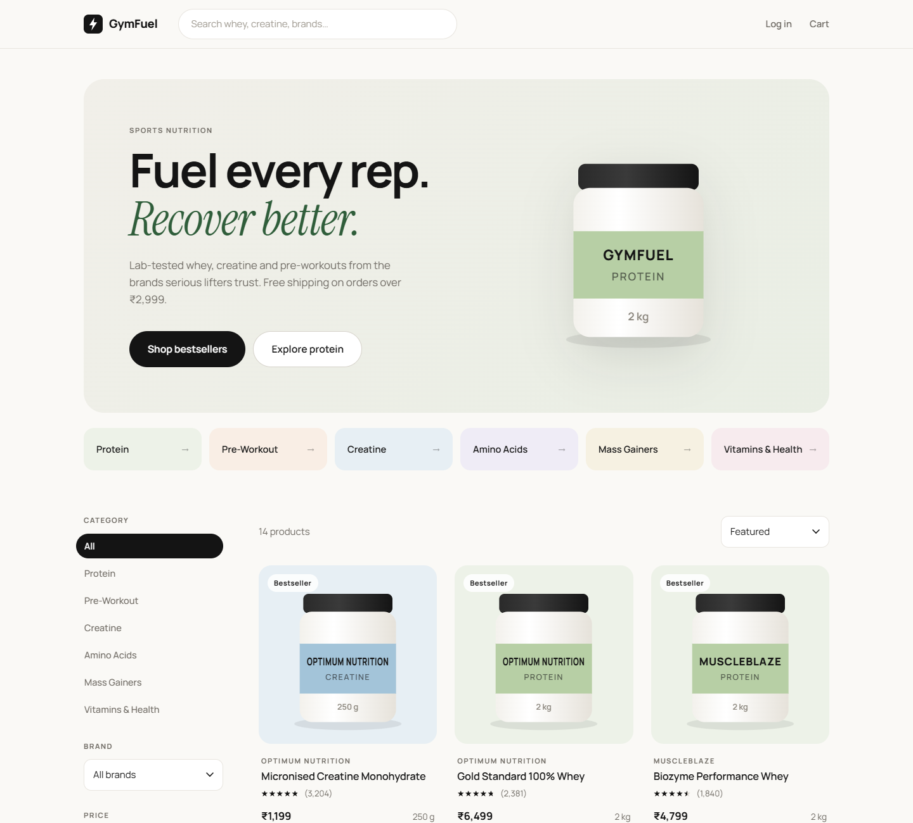
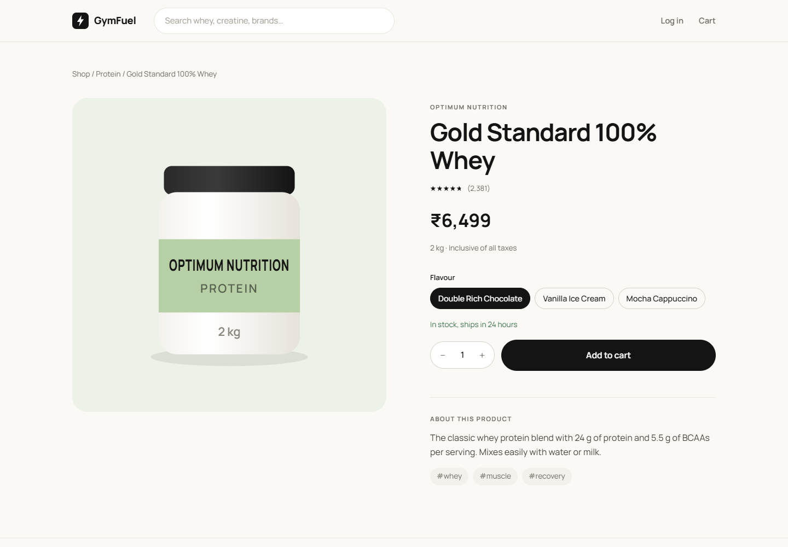
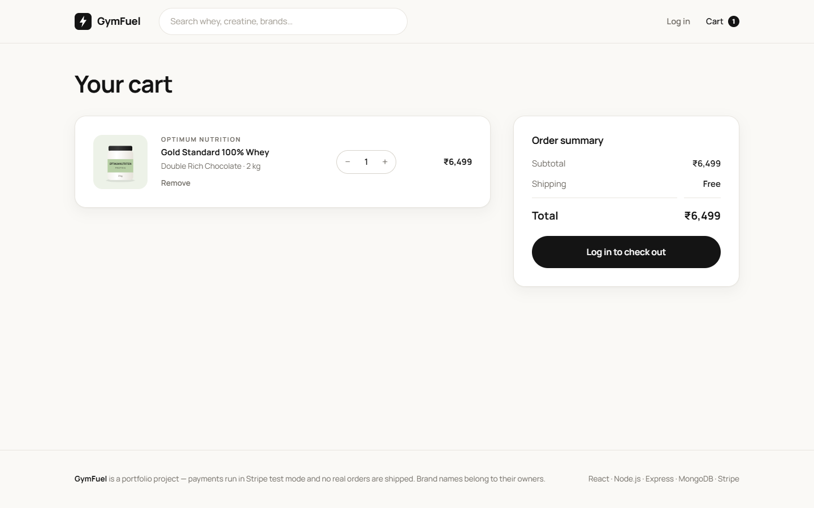
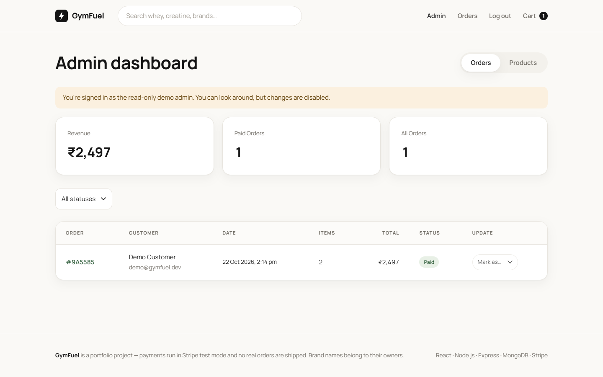

# GymFuel


A full-stack store for sports nutrition: whey, creatine, pre-workout, the usual shelf. Customers can search and filter the
catalogue, pay with Stripe and track their orders. Admins manage products and move orders from *paid* to *shipped* to
*delivered*.

**Try it:** [gymfuel-nu.vercel.app](https://gymfuel-nu.vercel.app)

On the login page, click **Demo customer** to shop, or **Demo admin** to look around the dashboard (it's read-only, so
nothing you click there breaks anything). Payments run in Stripe test mode: use card `4242 4242 4242 4242`, any future
date and any CVC.

> The API sleeps on Render's free tier. If the first page load hangs for ~30 seconds, that's it waking up.



<table>
  <tr>
    <td width="33%"></td>
    <td width="33%"></td>
    <td width="33%"></td>
  </tr>
  <tr>
    <td align="center"><sub>Product page</sub></td>
    <td align="center"><sub>Cart</sub></td>
    <td align="center"><sub>Admin dashboard (read-only demo)</sub></td>
  </tr>
</table>

---

## Why I built it

I wanted one project that covered everything a real online store has to get right: logins and roles, a catalogue
people can actually search, and payments that don't go wrong when the network does. Supplements felt like a good fit
because the catalogue has a lot of real filtering (brand, category, price, stock), and I use this stuff
myself.

## What it does

- **Search and filters that live in the URL.** Search by name, brand or tag, filter by category, brand, price and stock,
  then sort and paginate. Every filter is part of the URL, so you can share or bookmark a result page.
- **Accounts and roles.** JWT auth with bcrypt-hashed passwords and a rate-limited login. There are two roles,
  `customer` and `admin`, plus a public demo admin that can see everything but change nothing.
- **Checkout the server controls.** The cart in the browser is only a wish list. At checkout the API recalculates prices,
  stock and shipping itself, so editing the cart in dev tools can't change what you're charged.
- **Payments that survive real-world mess.** Stripe Checkout takes the payment, and a signed webhook marks the order as
  paid and takes the items out of stock. While building it I ran into the cases that actually matter:
  - Stripe can deliver the same webhook twice, so marking an order paid is idempotent and stock never drops twice.
  - The customer can land back on the site before the webhook arrives, so the order page asks Stripe directly and
    shows the right status straight away.
  - People abandon checkout, so unpaid sessions expire after 30 minutes and the order is cancelled.
- **An admin dashboard** with revenue and order stats, product create/edit/delete, and an order workflow that rejects
  impossible moves (you can't ship an order that was never paid).

## Tech stack

| | |
|---|---|
| Frontend | React 18, React Router, Vite, deployed on Vercel |
| Backend | Node.js, Express 5, Mongoose, Zod validation, Helmet, rate limiting |
| Database | MongoDB Atlas |
| Payments | Stripe Checkout and webhooks (test mode) |
| Testing | Vitest, Supertest, an in-memory MongoDB |
| DevOps | Docker, GitHub Actions, Render |

## How it fits together

```
 React (Vercel) ──REST + JWT──▶ Express API (Render, Docker) ──▶ MongoDB Atlas
        │                               ▲
        └──redirect──▶ Stripe Checkout ─┘ webhook: checkout.session.completed
```

```
server/src/
  app.js            security middleware, routes, error handling
  routes/           auth, products, orders, Stripe webhooks
  models/           User, Product, Order
  middleware/       JWT auth and roles, Zod validation, errors
  lib/payments.js   Stripe sessions, idempotent "mark paid", a mock provider for local dev
  seed.js           demo catalogue and accounts
server/test/        API tests
client/src/
  pages/            shop, product, cart and checkout, orders, auth, admin
  context/          auth and cart state (the cart is saved in localStorage)
```

## Tests

There are 22 API tests covering auth and roles, catalogue queries, checkout pricing, stock rules and Stripe webhook
signatures. They run against an in-memory MongoDB, so they need no setup, and GitHub Actions runs them on every push.

## Running it locally

You need Node.js 20 or newer, and that's it. With no `MONGODB_URI` the API starts an in-memory database with demo
data. With no Stripe key, checkout uses a simulated payment page.

```bash
cd server && npm install && npm run dev     # API on http://localhost:4000
cd client && npm install && npm run dev     # app on http://localhost:5173
cd server && npm test
```

Demo logins: `demo@gymfuel.dev` / `demo12345` (customer) and `demo.admin@gymfuel.dev` / `demoadmin123` (read-only
admin). Locally there's also a full admin, `admin@gymfuel.dev` / `ChangeMe-Admin-123`.

To try real Stripe test payments locally, put your test keys in `server/.env` and forward webhooks with the
[Stripe CLI](https://docs.stripe.com/stripe-cli):

```bash
stripe listen --forward-to localhost:4000/api/webhooks/stripe
```

<details>
<summary><strong>API reference</strong></summary>

| Method | Endpoint | Who |
|---|---|---|
| POST | `/api/auth/register`, `/api/auth/login` | anyone |
| GET | `/api/auth/me` | signed in |
| GET | `/api/products?q=&category=&brand=&minPrice=&maxPrice=&inStock=&sort=&page=` | anyone |
| GET | `/api/products/facets`, `/api/products/:slug` | anyone |
| POST / PATCH / DELETE | `/api/products/:id` | admin |
| POST | `/api/orders/checkout` | signed in |
| GET | `/api/orders/mine`, `/api/orders/:id` | signed in (own orders) |
| GET | `/api/orders` | admin |
| PATCH | `/api/orders/:id/status` | admin |
| POST | `/api/webhooks/stripe` | Stripe (signed) |

</details>

## Deploying

[DEPLOY.md](DEPLOY.md) walks through the whole thing: MongoDB Atlas, then the API on Render, the frontend on Vercel, and
finally the Stripe webhook.

## What I'd add next

- Product reviews and ratings from verified buyers
- Order confirmation emails
- Discount codes, applied server-side like the rest of the pricing
- An image upload flow for admins instead of pasting URLs

---

Built by [Dhruv Thakur](https://github.com/dhruvthakur1).
